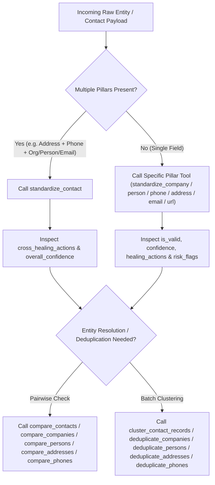

# AI Agent & Model Context Protocol (MCP) Integration Guide 🤖

**Entity Standardizer** (`entity_standardizer` `v2.1.0`) is designed from the ground up for autonomous AI agents, LLM tool-calling pipelines, and Model Context Protocol (MCP) hosts (Claude Desktop, Cursor, Windsurf, Google Antigravity, and custom JSON-RPC 2.0 clients).

---

## 1. Quick Context Ingestion (`llms.txt`)

Point any LLM or coding agent at **[`llms.txt`](../llms.txt)** in the repository root for a compact, token-efficient summary of all 6 entity pillars, canonical Python imports, and operational invariants.

---

## 2. Configuring the MCP Server (`entity-standardizer-mcp`)

The package installs a zero-latency stdio JSON-RPC 2.0 MCP server (`entity-standardizer-mcp`).

### Claude Desktop / Cursor / Windsurf / Antigravity (`mcp_config.json`)

```json
{
  "mcpServers": {
    "entity-standardizer": {
      "command": "entity-standardizer-mcp",
      "args": []
    }
  }
}
```

Or invoke directly via Python module:

```json
{
  "mcpServers": {
    "entity-standardizer": {
      "command": "python",
      "args": ["-m", "entity_standardizer.mcp.server"]
    }
  }
}
```

---

## 3. Complete MCP Tool Catalog (25 Tools)

| Tool Name | Purpose | Required Arguments |
| :--- | :--- | :--- |
| `standardize_contact` | Jointly standardize & cross-heal address, phone, fax, organization, person, title, email, website, and social fields | *(any subset of contact fields)* |
| `compare_contacts` | Multi-pillar entity comparison across organization, person, phone, email, website, and address | `contact_a`, `contact_b` |
| `cluster_contact_records` | Cluster a list of contact records across all 6 pillars into Golden Contact Clusters | `records` |
| `standardize_company` | ISO 20275 ELF legal suffix normalization, Latin diacritic folding, SEC `/DE/` stripping, DBA/FKA/Series extraction | `name` |
| `compare_companies` | Compare two company names across exact key, base name, DBA/acronym alias, brand stem, and phonetic keys | `company_a`, `company_b` |
| `deduplicate_companies` | Cluster a list of company strings into Golden Company Records | `companies` |
| `standardize_person` | Parse salutation, given/middle/surname, nickname, credentials, root name (`Bob` $\to$ `ROBERT`), and org guard | `name` |
| `compare_persons` | Compare two person names across exact key, root nickname, first initial, and phonetic keys (with `Jr.`/`Sr.` conflict guard) | `person_a`, `person_b` |
| `deduplicate_persons` | Cluster a list of person full-name strings into Golden Person Records | `persons` |
| `standardize_job_title` | Unpack JSON role arrays, expand abbreviations (`CCO`, `FINOP`, `SVP`), and classify `seniority_level`, `department`, and `is_executive` | `title` |
| `standardize_email` | RFC 5321/5322 normalization, `+tag` & Gmail dot folding, domain typo healing, and sentinel/disposable rejection | `email` |
| `compare_emails` | Compare two email addresses across exact canonical email, domain-variant corporate local part, and subaddress equivalence | `email_a`, `email_b` |
| `standardize_url` | Upgrade to `https://`, strip `www.` & tracking params (`utm_*`, `gclid`), and extract eTLD+1 `domain` and `brand_stem` | `url` |
| `compare_urls` | Compare two website URLs across exact URL, registrable domain (`eTLD+1`), and brand stem | `url_a`, `url_b` |
| `standardize_social` | Canonicalize social handles and URLs across `LINKEDIN`, `X`, `GITHUB`, `INSTAGRAM`, `FACEBOOK`, and `YOUTUBE` | `profile` |
| `standardize_address` | USPS Pub 28 / UPU S42 physical address standardization, rooftop geocoding, and `normalized_address_key` / `building_key` | *(address fields)* |
| `compare_addresses` | Compare two physical addresses across exact `normalized_address_key`, `building_key`, `phonetic_key`, and rooftop fuzzy distance | `address_a`, `address_b` |
| `deduplicate_addresses` | Cluster a list of physical addresses into Golden Address Records | `addresses` |
| `autocomplete_address` | Real-time street address typeahead autocomplete suggestions | `prefix` |
| `standardize_phone` | Parse and validate telephone numbers into E.164, National, International, and RFC 3966 across 249 countries | `phone` |
| `explain_phone` | Return locality, IANA timezones, carrier MNO hint, TCPA safe-calling window (`08:00–21:00`), and risk breakdown | `phone` |
| `compare_phones` | Compare two phone numbers across E.164 equivalence, extension variants, and keypad/transposition typos | `phone_a`, `phone_b` |
| `deduplicate_phones` | Cluster a list of phone strings into Golden Phone Records | `phones` |
| `mask_phone` | Redact PII using `partial`, `partial_phone`, `last4`, `redact`, `null`, `hash`, `sha256`, or `md5` strategies | `phone` |
| `lookup_country_dial_plan` | Retrieve ITU-T calling code, trunk prefix, and NSN lengths for any of the 249 ISO-3166-1 jurisdictions | `identifier` |

---

## 4. AI Agent Decision Tree & Self-Correction Playbook

When an AI agent is tasked with cleaning, validating, or linking entity records, follow this deterministic decision tree:



### Handling Diagnostic Flags in Autonomous Workflows

1. **Corporate Name Misplaced in Person Field (`is_organization: true`)**:
   - If `standardize_person(name)` returns `is_valid: false` and `is_organization: true` (e.g. `"Augnition Global Investors US GP, LLC"`), route the value to `standardize_company(name)`—or use `standardize_contact()`, which automatically rescues it into `contact.organization` (`ORGANIZATION_RESCUED_FROM_PERSON_FIELD`).
2. **Joint / Couple Names (`"Mr. and Mrs. Robert J. Smith"`, `"John & Jane Smith"`)**:
   - Call `split_compound_persons(raw_input)` in Python to split joint household/deed/donor strings into two distinct `StandardizedPerson` records before inserting into a person table.
3. **Telephony Routing Tiers & Anti-Fraud Guardrails**:
   - `routing_tier == "AUTO_PASS"` (`confidence >= 0.85`, no critical risk flags): Safe for automated CRM upsert and outbound dialing.
   - `routing_tier == "FUZZY_REVIEW"` (`0.60 <= confidence < 0.85`): Flag for secondary verification or cross-pillar corroboration.
   - `routing_tier == "MANUAL_STEWARDSHIP"` (`confidence < 0.60` or invalid): Do not auto-dial; inspect `risk_flags`.
   - If `"PREMIUM_RATE_IRSF_RISK"` is present in `risk_flags`: **Immediately block** automated SMS/Voice OTP dispatch to prevent International Revenue Share Fraud.
4. **Registered Agent & CMRA Address Hubs**:
   - When `address.is_registered_agent_hub` or `address.cmra` is `True` (e.g., `1209 Orange St, Wilmington, DE`), **never** merge two unrelated companies solely because they share `normalized_address_key`. Both `cluster_contact_records()` and `compare_contacts()` enforce this invariant automatically.
5. **Caching Architecture & Persistence**:
   - The engine utilizes a two-tier caching architecture (`L1 LRU` + `L2 SQLite WAL`). Table schemas include semantic comments (`-- Cache for StandardizedPhone records`) to ease manual inspection.
